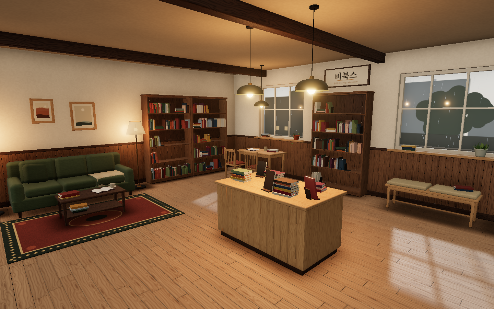

# 비북스 · 원미서가 (readplace v2)

부천 원미동 동네 서점 **비북스**를 옮긴 3D 온라인 공간입니다. 방문객이 아바타로 들어와 비 오는 오후의 서점에 앉아, 각자 자기 책을 함께 읽습니다. 실제 책 본문은 보여주지 않습니다.

> 진행 상황: **단계 1·2 완료**(기반 + 서점 장면). 아바타·HUD·함께 있기·읽기 모드는 다음 세션에서 진행합니다. 자세한 내용은 `PROGRESS.md`에 있습니다.



## 실행

```bash
npm install
```

```bash
npm run dev
```

브라우저에서 `http://localhost:5173`을 열고 "들어가기"를 누릅니다.

| 명령 | 하는 일 |
|---|---|
| `npm run dev` | 개발 서버 |
| `npm run build` | 정적 파일 빌드(`dist/`) |
| `npm run preview` | 빌드 결과 미리보기(4173 포트) |
| `npm run typecheck` | 타입 검사 |
| `npm run capture` | 빌드 후 헤드리스 크로미움으로 `docs/screens/`에 스크린샷 저장. `npm run capture -- overview`처럼 이름을 골라 찍을 수도 있음 |
| `npm run server` | 실시간 중계 서버(단계 5에서 추가) |
| `npm run test:e2e` | e2e 테스트(단계 5·8에서 추가) |

### URL 파라미터

| 파라미터 | 뜻 |
|---|---|
| `seed=86` | 서점 배치 시드. 같은 시드면 항상 같은 서점 |
| `quality=low\|medium\|high` | 그래픽 품질(없으면 기기 자동 판별) |
| `cam=overview\|window\|avatar` | 고정 시점(캡처용). 지정하면 시작 화면을 건너뜀 |
| `autostart=1` | 시작 화면 건너뛰기 |
| `debug=1` | 좌하단에 FPS·드로우콜·삼각형 수 표시 |
| `room=wonmi&instance=86` | 방(원미서가 86) |
| `fx=noao,nobloom` | 진단용: 후처리 패스 끄기 |

## 기술 스택과 패키지

- three **0.187.0**(고정), Vite 8, TypeScript. React는 쓰지 않습니다.
- 후처리: EffectComposer → RenderPass → GTAO(높음) / SAO(보통) → UnrealBloom → OutputPass. ACES 톤매핑, sRGB 출력.
- 글꼴: `@fontsource/noto-serif-kr`(제목), `pretendard`(본문). 로컬 번들이라 오프라인에서도 보입니다.
- 개발용: `@playwright/test`(캡처·테스트), `tsx`(스크립트 실행), `@types/three`, `@types/node`.
- SPEC에 없는 패키지는 추가하지 않았습니다.

## 구조

```
src/core/      시드 난수, URL 파라미터, 품질 단계, 렌더 루프
src/scene/     장면 조립(bookstore), 배치(layout), 재질·절차 텍스처, 조명, 후처리, 창밖, props/*
src/controls/  카메라(단계 3에서 이동·경로 탐색 추가)
src/ui/        로딩 화면(단계 4에서 HUD·토스트·설정 추가)
scripts/       캡처 스크립트
docs/screens/  스크린샷과 시각 품질 판정(REVIEW.md)
assets/models/ 외부 glb 교체용(비어 있음)
```

## 외부 모델(glb)로 바꾸기

`assets/models/{이름}.glb`를 넣고 다시 빌드하면, 해당 소품은 절차 모델 대신 glb를 씁니다. 지금 지원하는 이름은 `island`, `reading-table`, `counter`, `sofa`입니다. 모델 원점은 바닥 중앙, 정면은 +z 기준입니다. 어떤 파일이 있는지는 빌드할 때 확인하므로, 없는 파일을 요청해 404가 나지는 않습니다.

## 성능 (보통 품질, 헤드리스 측정, 프레임 전체 기준)

- 드로우콜 113, 삼각형 약 38만 → 예산(드로우콜 150, 삼각형 60만) 안
- 정적 소품은 재질별로 병합합니다(재질 하나 = 드로우콜 하나). 책은 InstancedMesh 2개(표지·페이지)를 씁니다.
- 그림자는 시작할 때와 품질을 바꿀 때만 다시 그립니다(`shadowMap.autoUpdate = false`).

## 알려진 한계

- Local 모드는 **같은 브라우저의 탭끼리만** 함께 있는 것처럼 보입니다. 다른 기기끼리 만나려면 ws 서버나 Realtime 서비스가 필요합니다(단계 5).
- 헤드리스 캡처는 소프트웨어 렌더링이라 실제 화면보다 그림자·AO 품질이 낮게 나올 수 있습니다.

## 남은 이슈

- three r187에서 `PCFSoftShadowMap`이 없어져 `PCFShadowMap` + `shadow.radius`로 부드러운 그림자를 냅니다.
- 실내 그림자 광원은 PointLight 대신 SpotLight입니다. PointLight 그림자는 6방향을 그려 비용이 6배이기 때문입니다(운영자 승인).
- 높음 품질의 창유리 빗방울 셰이더는 아직 없습니다.
- 단계 3 전까지는 임시로 OrbitControls로 둘러봅니다.
