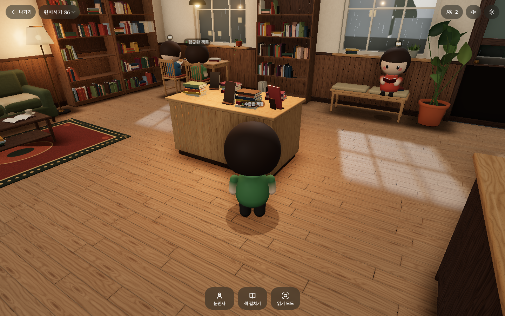

# 비북스-M (readplace v2)

부천 원미동 동네 서점 **비북스**를 옮긴 3D 온라인 공간입니다. 방문객이 아바타로 들어와 부천 날씨에 맞는 서점에 앉아, 각자 자기 책을 함께 읽습니다. 실제 책 본문은 보여주지 않습니다.

> 진행 상황: **단계 1~8 완료**(서점 장면, 아바타·이동, HUD, 함께 있기, 읽기 모드, 소리·PWA·접근성, e2e·최종 캡처). 배포: https://meta.bbooks.co.kr/ · 단계별 기록은 `PROGRESS.md`, 시각 품질 판정은 `docs/screens/REVIEW.md`.



## 사용법

- **걷기**: 바닥을 누르면 걸어갑니다(가구는 돌아갑니다). 설정에서 켜면 WASD·방향키로도 걸을 수 있습니다.
- **앉기**: 의자·소파·창가 벤치를 누르면 가장 가까운 빈 자리로 가서 앉습니다.
- **둘러보기**: 드래그로 돌리고, 휠·핀치로 확대·축소합니다. 멀리 당기면 서점 전체를 조망할 수 있습니다.
- **하단 버튼**(연결된 뒤 사용 가능): 눈인사(1) · 책 펼치기(2) · 읽기 모드(3). 책 펼치기·읽기 모드에 들어가면 제목·저자·출판사를 넣고, 온라인 서점에서 표지를 찾아 보여 줍니다(본문은 없음). 읽기 모드에서는 Esc 또는 "돌아가기"로 나옵니다.
- **상단**: 나가기, 서점 이름(비북스-M), 지금 함께 있는 사람 수(최대 20명), 소리, 설정(품질·닉네임·아바타 색·머리 모양·모션 줄이기·NPC 독자·서점 음악·자연 소리·키보드 이동). 20명이 차 있으면 들어가지 않고 안내 화면이 나옵니다. 1인 작업실은 한 명만.
- **읽기 모드**: 책 본문은 보여주지 않습니다. 각자 자기 책(종이책·전자책)을 읽는 동안 서점이 배경으로 남고, 표지·제목·저자·출판사, "함께 읽는 중 N명", 이번 독서 시간, 오늘 읽은 시간이 보입니다. 표지는 **카카오 책 검색**(중계 서버 프록시) → Google Books → Open Library 순으로 찾고, 없으면 제목으로 만든 표지를 씁니다. 메타·읽은 시간은 이 브라우저에만 저장됩니다.
- **소리·날씨**: 기본 소리는 꺼짐. 켜면 YouTube 잔잔한 서점 BGM(설정에서 끄기 가능)과 빗소리·새소리 자연 앰비언트(설정에서 세기 조절). 창밖 연출은 **부천 실시간 기상**(Open-Meteo, 실패 시 비). `?weather=rain|snow|clear`로 고정할 수 있습니다.
- **가오픈 포스트잇**: 허브 창가 보드를 누르면 확대되어 색·모양·짧은 메시지(40자)를 붙일 수 있습니다. 기본은 이 브라우저에 저장되고, Supabase에 `bbooks_postits` 테이블(`supabase/postits.sql`)이 있으면 서로 보입니다.
- **매니저 계정**: 시작 화면 제목의 **M**을 누르면 코드 입장이 열립니다(기본 코드 `suddenly2026`, `VITE_MANAGER_CODE`로 변경). 서든리 매니저(대표) 전용 아바타로 들어갑니다.
- **키보드**: Tab으로 버튼 순회, Enter·Space로 누르기, 1·2·3으로 하단 동작, Esc로 시트·읽기 모드 닫기, 설정에서 켜면 WASD·방향키로 걷기. 시스템 "동작 줄이기" 또는 설정의 "모션 줄이기"를 켜면 카메라 전환·페이드·비 파티클이 꺼집니다.
- **앱으로 설치**: 크롬·엣지·사파리(홈 화면에 추가)에서 설치할 수 있고, 한 번 열어 둔 뒤에는 오프라인에서도 열립니다(Local 모드).

## 실행

```bash
npm install
```

```bash
npm run dev
```

브라우저에서 `http://localhost:5173`을 열고 "책방 입장하기"를 누릅니다.

| 명령 | 하는 일 |
|---|---|
| `npm run dev` | 개발 서버 |
| `npm run build` | 정적 파일 빌드(`dist/`) |
| `npm run preview` | 빌드 결과 미리보기(4173 포트) |
| `npm run typecheck` | 타입 검사 |
| `npm run capture` | 빌드 후 헤드리스 크로미움으로 `docs/screens/`에 스크린샷 저장. `npm run capture -- overview`처럼 이름을 골라 찍을 수도 있음 |
| `npm run server` | 실시간 중계 서버(ws, 기본 8787 포트, `PORT`로 변경) |
| `npm run test:e2e` | e2e 테스트 4개(빌드·미리보기·중계 서버를 알아서 띄움. 소프트웨어 렌더링이라 Mac에서 약 5분) |
| `npm run perf` | 품질별 드로우콜·삼각형·텍스처 크기 기록 → `docs/perf.json`(`-- --gpu`면 이 컴퓨터 GPU로 fps까지 → `docs/perf-gpu.json`) |
| `npm run icons` | `public/icons/icon.svg`로 192·512 PNG 아이콘 다시 만들기 |

처음 한 번은 캡처·테스트용 크로미움이 필요합니다.

```bash
npx playwright install chromium
```

### e2e가 확인하는 것

1. **함께 있기(Local)**: 같은 브라우저 탭 2개 → 서로의 아바타·이름표, 접속자 수 2, 들어옴 알림, 눈인사 알림, 책 펼치기 상태, 나감 알림·접속자 수 1
2. **함께 있기(ws)**: 위와 같은 흐름을 중계 서버로, 저장소가 다른 브라우저 컨텍스트 2개
3. **읽기 모드**: 키 3 → 집중 화면·타이머가 오름 → 다른 탭도 읽으면 양쪽 "함께 읽는 중 2명" → Esc·돌아가기 → 앉아 있던 쪽은 sit, 서 있던 쪽은 stand로 복귀, 오늘 읽은 시간 저장
4. **키보드·클릭·소리·PWA**: 동작 줄이기 켠 상태로 Tab→Enter 입장, Tab 정지점마다 이름·포커스 링, 설정 시트 Esc·포커스 복귀, 소리 켜기(AudioContext 실행·게인 상승)·끄기, 바닥 클릭 이동, WASD, 의자·벤치 클릭으로 앉기, 1 눈인사, 3 읽기 모드(숨긴 HUD에 Tab이 닿지 않음), manifest·서비스워커

모든 테스트는 콘솔 에러 0개를 함께 확인합니다.

### 다른 기기끼리 함께 있기(ws 모드) · 카카오 표지

```bash
# .env에 KAKAO_REST_API_KEY=REST API 키
npm run server
```

그다음 `http://localhost:5173/?presence=ws&ws=ws://localhost:8787` 처럼 엽니다. 같은 와이파이의 다른 기기에서는 `localhost` 대신 이 컴퓨터의 IP를 씁니다.

표지 검색은 개발 서버가 `/api/kakao`를 8787로 넘깁니다. `KAKAO_REST_API_KEY`가 있으면 카카오 책 검색을 먼저 치고, 없거나 실패하면 Google Books·Open Library로 이어집니다.

키 발급: [카카오 디벨로퍼스](https://developers.kakao.com) → 애플리케이션 → **REST API 키**. 제품 설정에서 **Daum 검색**을 활성화하세요. `.env.example`을 참고해 `.env`에만 넣고 커밋하지 마세요.

### URL 파라미터

| 파라미터 | 뜻 |
|---|---|
| `seed=86` | 서점 배치 시드. 같은 시드면 항상 같은 서점 |
| `quality=low\|medium\|high` | 그래픽 품질(없으면 기기 자동 판별) |
| `cam=overview\|window\|avatar` | 고정 시점(캡처용). 지정하면 시작 화면을 건너뜀 |
| `autostart=1` | 시작 화면 건너뛰기 |
| `debug=1` | 좌하단에 FPS·드로우콜·삼각형 수 표시 |
| `room=wonmi&instance=86` | 함께 있는 방. 화면의 입장은 원미서가 한 곳이고, `instance`는 테스트에서 방을 나눌 때만 씁니다 |
| `cap=20` | 입장 상한(1~20, 기본 20). 테스트용 |
| `presence=ws&ws=ws://…` | 중계 서버로 연결(기본은 같은 브라우저 탭끼리). 표지 프록시 origin도 여기서 추론 |
| `api=http://localhost:8787` | 카카오 표지 프록시 origin을 직접 지정 |
| `presence=supabase` | Supabase Realtime 함께 있기(env에 URL·키 필요). 미지정이면 env 있으면 자동 |
| `presence=local` / `ws` | 탭 간 BroadcastChannel / 로컬 ws 서버 |
| `npc=0` | NPC 독자 숨기기 |
| `autoread=1` | 바로 읽기 모드 |
| `weather=rain\|snow\|clear` | 부천 실시간 날씨 대신 연출 고정(캡처·테스트용) |
| `seat=sofa-2` | 앉은 채로 시작(캡처·테스트용) |
| `fx=noao,nobloom` | 진단용: 후처리 패스 끄기 |

## 기술 스택과 패키지

- three **0.187.0**(고정), Vite 8, TypeScript. React는 쓰지 않습니다.
- 후처리: EffectComposer → RenderPass → GTAO(높음) / SAO(보통) → UnrealBloom → OutputPass. ACES 톤매핑, sRGB 출력.
- 글꼴: `@fontsource/noto-serif-kr`(제목), `pretendard`(본문). 로컬 번들이라 오프라인에서도 보입니다.
- 실시간: `ws`(중계 서버). 개발용: `@playwright/test`(캡처·테스트·성능 측정·아이콘 PNG 생성), `tsx`(스크립트·서버 실행), `@types/three`, `@types/node`, `@types/ws`(타입 검사).
- 소리는 Web Audio, PWA는 직접 쓴 서비스워커 + 작은 Vite 플러그인(`vite.config.ts`의 `bbooks-pwa`)으로 만들어 패키지를 더하지 않았습니다.
- SPEC에 없는 패키지는 꼭 필요할 때만 추가합니다. `@supabase/supabase-js`는 Pages에서도 다른 기기 함께 있기·카카오 표지 프록시를 위해 넣었습니다. `page-flip`은 v3.1에서 책 본문을 빼면서 쓰지 않습니다.

## 구조

```
src/core/      시드 난수, URL 파라미터, 품질 단계, 렌더 루프
src/scene/     장면 조립(bookstore), 배치(layout), 재질·절차 텍스처, 조명, 후처리, 창밖, props/*
src/app.ts     앱 조립(장면·아바타·이동·HUD·함께 있기·읽기 모드)
src/avatar/    아바타 모델·애니메이션·이름표·NPC·여러 아바타 관리(crowd)
src/controls/  3인칭 카메라, 경로 탐색(A*), 이동·앉기, 포인터·키보드 입력
src/net/       Presence 인터페이스, Local(BroadcastChannel)·Ws 구현, 닉네임
src/reader/    읽기 모드(집중 독서 화면)와 읽은 시간 기록
src/audio/     서점 BGM(YouTube)·자연소리·효과음(Web Audio)
src/pwa/       서비스워커 템플릿과 등록(빌드에서만)
src/ui/        로딩, HUD, 토스트, 시트, 설정
public/        manifest.webmanifest, icons/(SVG + 192·512 PNG)
server/        ws 중계 서버
tests/         e2e(Playwright)
scripts/       캡처(capture), 성능 기록(perf), 아이콘 PNG 생성(icons)
docs/screens/  스크린샷과 시각 품질 판정(REVIEW.md)
assets/models/ 외부 glb 교체용(비어 있음)
```

## 배포(GitHub Pages)

`main`에 올라오면 `.github/workflows/deploy.yml`이 타입 검사·빌드 후 https://meta.bbooks.co.kr/ 에 배포합니다. 처음 한 번은 저장소 Settings → Pages → Source를 **GitHub Actions**로 바꿔야 합니다. 정적 호스팅이라 Local 모드(같은 브라우저 탭끼리)로 동작하고, 다른 기기끼리 만나는 ws 모드는 중계 서버를 따로 띄워야 합니다.

- **커스텀 도메인**: `meta.bbooks.co.kr`(DNS에 `meta` CNAME → `yonghee0330.github.io`, Pages 설정의 Custom domain, HTTPS 강제). 이전 주소(`yonghee0330.github.io/readplace_v2/`)는 새 주소로 301 이동합니다. 도메인은 Pages 설정에 저장되어 있어 저장소에 CNAME 파일은 없습니다.
- Supabase 함께 있기·카카오 표지는 저장소 Secrets(`VITE_SUPABASE_URL`, `VITE_SUPABASE_PUBLISHABLE_KEY`)가 빌드에 들어갈 때 켜지고, Edge Function `kakao-search`는 `npx supabase functions deploy kakao-search --project-ref <ref> --no-verify-jwt`로 따로 배포합니다(카카오 키는 `supabase secrets set`).
- 모든 경로가 상대 경로(`base: './'`, manifest의 `start_url`·`scope`가 `./`, 서비스워커 `./sw.js`)라 하위 경로(`/readplace_v2/`)든 도메인 루트든 그대로 동작합니다.
- 다른 정적 호스팅(Cloudflare Pages·Netlify 등)은 `npm run build` 후 `dist/`를 올리면 됩니다.
- 서비스워커는 빌드 결과물에서만 등록됩니다(`npm run dev`에서는 등록하지 않음). 새로 배포하면 파일 목록 해시로 캐시 버전이 바뀌어 옛 캐시를 지웁니다.

## 서가의 책 바꾸기(책 추가 방법)

SPEC v3.1에 따라 이 서비스는 **실제 책 본문을 다루지 않습니다**(SPEC 9장 책 데이터·`public/books/`·리더는 없음). 사람들은 각자 자기 책을 읽고, 서가의 책은 공간을 채우는 장식입니다.

- 서가 책은 `src/scene/props/books.ts`가 시드 난수로 만듭니다. 색 팔레트는 `BOOK_PALETTE`(12색), 높이 18~26cm·두께 1~4cm, 같은 색 시리즈 묶음, 기운 책, 눕힌 더미, 빈틈 비율을 이 파일에서 조절합니다.
- 책 권수는 시드에 따라 530~700권입니다. `?seed=`를 바꾸면 다른 배치가 나오고, 같은 시드면 항상 같은 서가입니다.
- 나중에 실제 책 정보(제목·표지)를 서가에 붙이려면 InstancedMesh 인스턴스 번호와 책 정보를 잇는 표를 따로 두고, 클릭 판정은 `app.ts`의 `clickAt`에 추가하면 됩니다(지금은 범위 밖).

## 외부 모델(glb)로 바꾸기

`assets/models/{이름}.glb`를 넣고 다시 빌드하면, 해당 소품은 절차 모델 대신 glb를 씁니다. 지금 지원하는 이름은 `island`, `reading-table`, `counter`, `sofa`입니다. 모델 원점은 바닥 중앙, 정면은 +z 기준입니다. 어떤 파일이 있는지는 빌드할 때 확인하므로, 없는 파일을 요청해 404가 나지는 않습니다.

## Supabase 연동(함께 있기 + 카카오 표지)

GitHub Pages는 정적 호스팅이라, **다른 기기와 만나기**와 **카카오 표지(키 숨김)** 는 Supabase를 쓰면 됩니다. 패키지: `@supabase/supabase-js`(Realtime Presence·Broadcast·Edge Function 호출).

### 1) 프로젝트·환경 변수

1. [Supabase](https://supabase.com)에서 프로젝트 생성
2. Project Settings → API에서 **Project URL**과 **publishable**(또는 anon) 키 복사
3. 로컬 `.env`(커밋 금지):

```bash
VITE_SUPABASE_URL=https://xxxx.supabase.co
VITE_SUPABASE_PUBLISHABLE_KEY=sb_publishable_...
# 또는 VITE_SUPABASE_ANON_KEY=eyJ...
```

4. GitHub 저장소 Secrets에도 같은 이름으로 넣으면 Pages 빌드에 들어갑니다(`deploy.yml`).

URL에 `presence=`가 없고 위 env가 있으면 자동으로 **supabase** 모드입니다. 강제로 쓰려면 `?presence=supabase`, 끄려면 `?presence=local`.

### 2) 카카오 Edge Function

```bash
# CLI: https://supabase.com/docs/guides/cli
npx supabase login
npx supabase link --project-ref YOUR_REF
npx supabase secrets set KAKAO_REST_API_KEY=카카오REST키
npx supabase functions deploy kakao-search
```

함수 코드는 `supabase/functions/kakao-search`. 브라우저는 `VITE_SUPABASE_URL/functions/v1/kakao-search`로 호출합니다.

### 3) Realtime

대시보드에서 Realtime이 켜져 있으면 됩니다(기본 on). 채널 이름: `bbooks:{room}:{instance}`(공간 이동 시 `room-seminar`처럼 방마다 분리). 명단은 Presence, 위치·눈인사는 Broadcast입니다.

## 실시간 백엔드 바꾸기(다른 구현)

`src/net/presence.ts`의 `Presence` 인터페이스만 새로 구현하면 됩니다. 지금은 `local` · `ws` · `supabase` 세 가지입니다.

- Durable Objects: 방·인스턴스마다 객체 하나, `server/index.ts` 메시지 형식을 옮기면 클라이언트는 `WsPresence`를 그대로 씀

## 성능

`npm run perf`(헤드리스) · `npm run perf -- --gpu`(이 컴퓨터 GPU) 결과, 1440×900, seed 86, NPC 포함. `?debug=1`이면 좌하단에 FPS·메인 패스 콜·전체 콜·삼각형이 표시됩니다.

| 품질 | 시점 | 메인 패스 콜 / 삼각형 | 프레임 전체 콜 / 삼각형 | 텍스처 최대 | fps(Mac GPU) |
|---|---|---|---|---|---|
| 낮음 | 아바타 / 전체 | 70 / 21.0만 · 82 / 21.4만 | 71 / 21.0만 · 83 / 21.4만 | 1024px | 60 / 60 |
| 보통 | 아바타 / 전체 | 71 / 21.0만 · 83 / 21.5만 | 155 / 41.8만 · 179 / 42.9만 | 1024px | 60 / 60 |
| 높음 | 아바타 / 전체 | 72 / 20.8만 · 84 / 21.4만 | 155 / 41.6만 · 179 / 42.6만 | 1024px | 60 / 60 |

- 메인 장면 패스는 예산(드로우콜 150, 삼각형 60만, 텍스처 1024px) 안입니다.
- 프레임 전체에는 AO가 깊이·법선을 얻으려고 장면을 한 번 더 그리는 패스와 Bloom 단계가 들어가 보통·높음에서 150을 조금 넘습니다(남은 이슈 참고).
- 헤드리스 SwiftShader(캡처·테스트 조건)에서는 10~15fps라 fps는 참고만 합니다.
- 정적 소품은 재질별로 병합합니다(재질 하나 = 드로우콜 하나). 책은 InstancedMesh 2개(표지·페이지)를 씁니다.
- 그림자는 시작할 때와 품질을 바꿀 때만 다시 그립니다(`shadowMap.autoUpdate = false`).

## 알려진 한계

- Local 모드는 **같은 브라우저의 탭끼리만** 함께 있는 것처럼 보입니다. 다른 기기끼리 만나려면 ws 서버나 Realtime 서비스가 필요합니다(단계 5). 20명 제한도 그렇게 연결된 사람들에게만 적용됩니다. GitHub Pages 기본 배포는 브라우저끼리 연결되지 않아, 각자 혼자 있는 것으로 보입니다.
- 헤드리스 캡처는 소프트웨어 렌더링이라 실제 화면보다 그림자·AO 품질이 낮게 나올 수 있습니다.
- ws 모드에서 서버가 꺼져 있으면, 재연결을 시도할 때마다 브라우저가 `WebSocket connection ... failed`를 콘솔에 직접 남깁니다(앱이 막을 수 없는 브라우저 메시지). 연결된 동안에는 콘솔 에러가 없습니다.
- 닉네임·아바타 색은 이 브라우저(localStorage)에만 저장됩니다. 같은 브라우저 탭끼리 닉네임이 겹치면 나중 탭이 그 탭에서만 다른 닉네임을 씁니다.

## 남은 이슈

- three r187에서 `PCFSoftShadowMap`이 없어져 `PCFShadowMap` + `shadow.radius`로 부드러운 그림자를 냅니다.
- 실내 그림자 광원은 PointLight 대신 SpotLight입니다. PointLight 그림자는 6방향을 그려 비용이 6배이기 때문입니다(운영자 승인).
- 높음 품질의 창유리 빗방울은 유리 바로 안쪽에 셰이더 판 하나(드로우콜 1)로 그립니다. 굴절 대신 밝기·투명도로 물방울을 표현하는 단순한 방식입니다.
- 이름표는 Sprite 대신 법선이 있는 평면 빌보드입니다. 이름표·책 아이콘·발밑 그림자는 오버레이 레이어에 두고 AO 계산에서 뺍니다(투명 판이 AO에 사각형 자국을 남기지 않게).
- 드로우콜 예산은 메인 장면 패스 기준으로 지킵니다. 보통·높음의 프레임 전체(155~179콜)는 AO가 법선 패스로 장면을 한 번 더 그리기 때문입니다. 줄이려면 메인 패스에서 법선을 함께 뽑는(MRT) 방식이 필요한데, three 기본 패스를 크게 고쳐야 해서 이번에는 하지 않았습니다. 실제 GPU(Mac)에서는 60fps가 나옵니다.
- 서비스워커는 앱 껍데기(html·js·css·manifest·아이콘)만 설치 때 미리 받고, 글꼴(부분 집합 파일이 많음)은 쓰는 만큼만 캐시합니다. 첫 방문에 서비스워커가 붙기 전에 받은 파일은 페이지가 목록을 넘겨 캐시하게 했습니다.
- SPEC 3-12의 "books/*.json 캐시"는 v3.1에서 책 데이터가 없어져 해당 없음입니다.
- 소리는 첫 사용자 동작 뒤에만 시작합니다. 지난번에 소리를 켜 두었으면 버튼은 켜짐으로 보이지만, 첫 클릭·키 입력이 있어야 실제로 들립니다(브라우저 자동 재생 정책).
- 캡처·e2e는 SwiftShader 소프트웨어 렌더링이라 Mac에서도 한 장면에 수십 초가 걸립니다. 캡처는 준비 완료 뒤 렌더 루프를 멈추고 찍습니다.
- 마루 결 무늬가 합판처럼 굵게 휘어 보입니다. 곧은 오크 결로 더 차분하게 다듬을 여지가 있습니다(`docs/screens/REVIEW.md` 다음에 볼 것).
- 기본 아바타 시점은 22°·시선 높이 0.9m로, 세션 3에서 서가가 더 보이도록 조금 올렸습니다.
- 읽기 모드 카메라는 어깨 너머 대신 앞쪽 비스듬한 위에서 책 읽는 내 아바타를 봅니다(머리가 큰 아바타라 어깨 너머로는 책이 가려짐).
